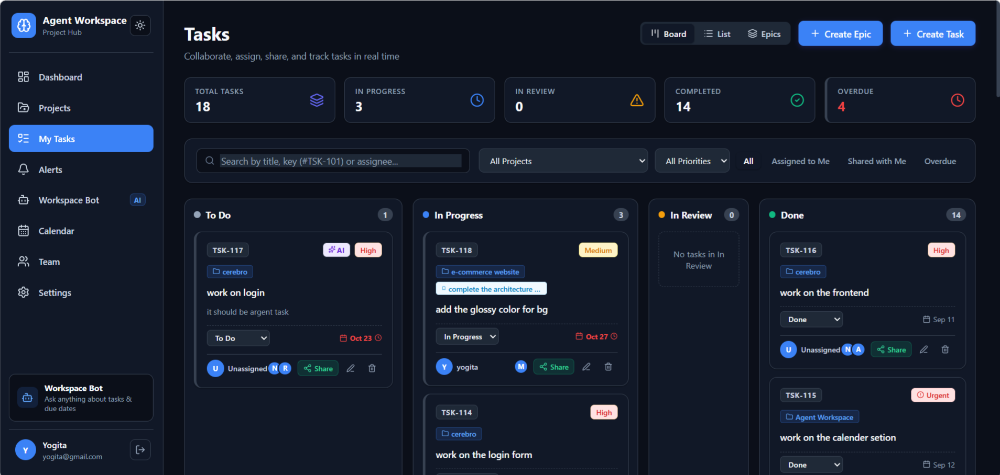
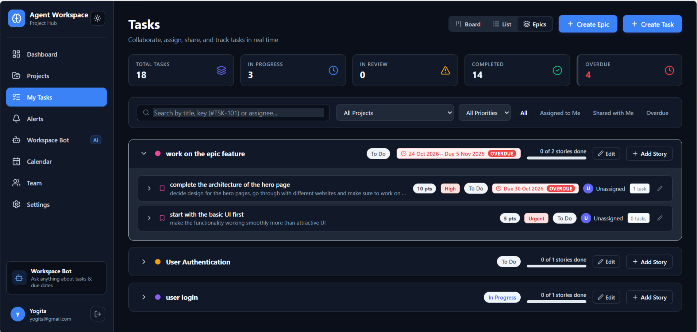
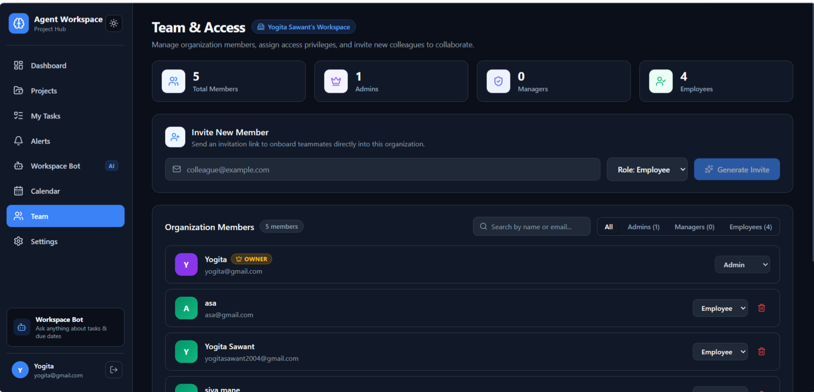

<div align="center">

# Agent Workspace

### Plan it. Assign it. Ship it.

A project management app where companies turn big goals into **Epics → Stories → Tasks**, assign them to the right people, and track progress on a **Kanban board**.


</div>

---

## The problem

In most teams, work is scattered across chats, sheets, and people's memory. Nobody is fully sure who owns what, what is blocked, or how far a project really is. Managers ask for updates. Developers lose time answering them.

## The solution

Agent Workspace puts everything in one workspace:

| Problem in a team | How Agent Workspace solves it |
| --- | --- |
| Big goals never become clear tasks | Epic → Story → Task hierarchy breaks them down step by step |
| Nobody knows who owns what | Every task has an owner, assigned by the manager |
| Progress is unclear | Kanban board shows status of all work at a glance |
| Everyone can do everything | Admin / Manager / Employee roles control who can do what |
| Company data is mixed or exposed | Each organization has its own private workspace |
| Adding new people is slow | Invite link, and they are in |

**Built for:** small and mid-size teams and companies that want a simple, clear way to plan and track work.

Built end to end: auth, access control, data modeling, REST API, UI, and deployment.

---

## Screenshots

### Tasks with Kanban Board


### Epics View


### Team Page


---

## Highlights

- **Work hierarchy** — Epic → Story → Task, with Kanban board and List view in one Tasks page
- **Drag-and-drop board** — move tasks between statuses and reposition them
- **Organizations** — every team gets its own private workspace, with data fully separated
- **Invite links** — add teammates in one click, no manual setup
- **Role-based access** — Admin, Manager, Employee, enforced on both API and UI
- **JWT authentication** — protected routes on the client, verified tokens on the server
- **Team page** — see who is in your organization and their roles
- **Private chat sessions**
- **Light / dark theme**

---

## How it works

```text
Project
 └── Epic            Big goal or major area of work
      └── Story      One requirement from the user's point of view
           └── Task  One piece of work, tracked on the board
```

**Example**

```text
E-Commerce App
 ├── Epic: User Management
 │    ├── Story: User can register
 │    │    └── Task: Build registration API
 │    └── Story: User can log in
 │         └── Task: Add JWT authentication
 └── Epic: Orders
      └── Story: User can track an order
           └── Task: Add order status endpoint
```

Task status flow: `To Do → In Progress → Review → Done`

---

## Roles

| Role | What they can do |
| --- | --- |
| **Admin** | Manage the organization, members, and roles |
| **Manager** | Create projects, Epics, Stories, Tasks; assign work |
| **Employee** | See assigned work, update status, move tasks on the board |

---

## Architecture

```text
┌──────────────┐   HTTPS / JSON   ┌───────────────────┐        ┌───────────────┐
│ React client │ ───────────────▶ │ Express REST API  │ ─────▶ │ MongoDB Atlas │
│              │ ◀─────────────── │ JWT + role checks │ ◀───── │               │
└──────────────┘                  └───────────────────┘        └───────────────┘
```

- **Client:** React SPA. Routes are protected and the UI changes by role.
- **API:** Stateless Express server. Every request is checked for a valid token, then for organization and role, before any data is touched.
- **Database:** MongoDB. Every project and task belongs to an organization, and every query is filtered by it.

### Key decisions

| Decision | Reason |
| --- | --- |
| Every query is scoped to the organization | One team can never read another team's data |
| Project visibility is org-wide | Keeps v1 simple; per-project access is the next step |
| Epics, Stories, and Board live in one Tasks page | Users stay in one place instead of jumping between menus |
| Invite-link onboarding | Fits how small teams actually add people |
| Stateless JWT auth | Easy to scale and deploy on free-tier hosting |

---

## Tech stack

| Layer | Tech |
| --- | --- |
| Frontend | React, React Router, CSS |
| Backend | Node.js, Express.js |
| Database | MongoDB Atlas |
| Auth | JSON Web Tokens |
| Hosting | Render (API), Vercel (client) |
| Tools | Git, GitHub, VS Code, Postman |

---

## Run it locally

**Requirements:** Node.js 18+, npm, a MongoDB URI (local or Atlas)

```bash
git clone <repo-url>
cd agent-workspace
```

**Backend**

```bash
cd server
npm install
cp .env.example .env      # fill in values below
npm run dev
```

**Frontend**

```bash
cd client
npm install
npm run dev
```

### Environment variables

| App | Variable | Purpose |
| --- | --- | --- |
| Server | `PORT` | API port |
| Server | `MONGO_URI` | MongoDB connection string |
| Server | `JWT_SECRET` | Secret for signing tokens |
| Server | `CLIENT_URL` | Allowed frontend origin (CORS) |
| Client | `VITE_API_URL` | Base URL of the API |

---

## Project structure

```text
agent-workspace/
├── client/
│   └── src/
│       ├── components/
│       ├── pages/
│       ├── services/        # API calls
│       ├── hooks/
│       └── utils/
├── server/
│   ├── models/
│   ├── routes/
│   ├── controllers/
│   ├── middleware/          # auth + role checks
│   └── index.js
└── README.md
```

---

## What's next

- [ ] Per-project permissions
- [ ] Comments and @mentions
- [ ] Real-time updates and notifications
- [ ] Activity timeline
- [ ] Dashboards and reports
- [ ] File attachments

---

## Author

**Yogita** — Full-stack developer (React, Node.js, Express, MongoDB)

[LinkedIn](<https://www.linkedin.com/in/yogita-sawant-webdev>)
